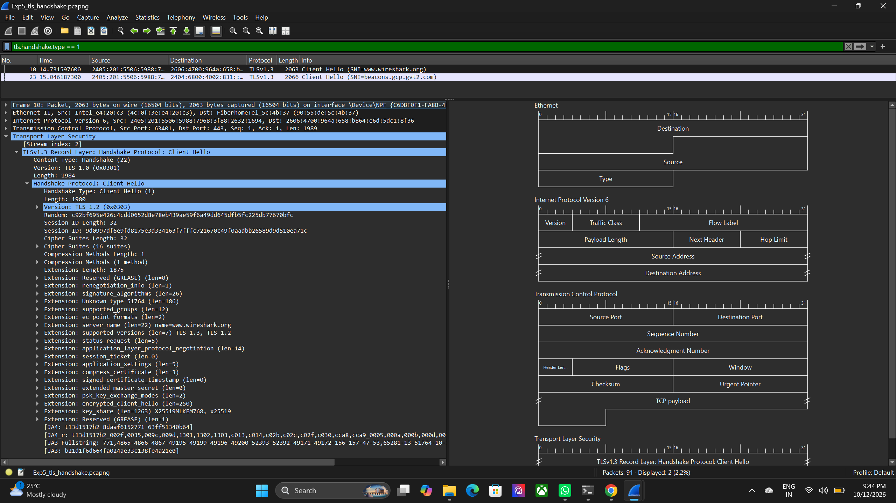
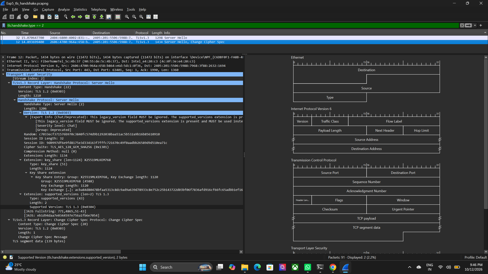

# Experiment 5: TLS Handshake Analysis using Wireshark

## Aim
This experiment helps us understand how a secure HTTPS connection starts. We use Wireshark to capture network traffic and study the TLS handshake between a client and a server.

## What is TLS?
TLS stands for Transport Layer Security. It is used to protect data sent over the internet. It keeps information private and checks that the server is genuine.

When a browser opens a secure website, it first performs a TLS handshake. During this process, the browser and server agree on:
- which TLS version to use
- which encryption method to use
- how to create a safe connection

## Tools Used
- Wireshark
- A browser using HTTPS
- Captured packet files

## Step 1: Capture the HTTPS traffic
We opened Wireshark and started capturing traffic while visiting a secure website. Then we saved the data as a packet capture file.

The capture files for this experiment are:
- [Original TLS handshake capture](Outputs/Exp5_tls_handshake.pcapng)
- [Decrypted TLS capture](Outputs/Exp5_tls_decrypted.pcapng)

## Step 2: Check the ClientHello message
The ClientHello message is the first message sent by the client to the server. It tells the server which TLS versions and security options the client supports.

### Observation
From the ClientHello packet, we can see:
- the client supports TLS 1.2 and TLS 1.3
- it offers different cipher suites
- it shares key information needed to begin secure communication

## Step 3: Check the ServerHello message
The server replies with a ServerHello message. This tells the client which TLS version and encryption method were chosen.

### Observation
The ServerHello shows:
- the selected TLS version
- the chosen cipher suite
- the server's key exchange details

## Step 4: Decrypt the TLS traffic
Wireshark can decrypt the captured session if the TLS key log file is available. This helps us see the later handshake messages that are normally hidden.

### Observation
After decryption, we can clearly see messages like:
- EncryptedExtensions
- Certificate
- CertificateVerify
- Finished

These messages show that the server and client are confirming the connection and preparing to exchange encrypted data.

## Step 5: Inspect the server certificate
The certificate is important because it proves the identity of the server. It contains the server name, validity dates, public key, and issuer information.

### Observation
From the certificate details, we can identify:
- the certificate holder
- the issuer
- the validity period
- the public key information
- the security algorithm used

## Result
This experiment showed how a secure HTTPS connection is created step by step. We successfully observed:
- ClientHello from the browser
- ServerHello from the website
- TLS certificate exchange
- handshake decryption
- secure session setup

## Simple conclusion
TLS is the security method used in HTTPS. Wireshark helps us see the communication details of this process. By observing ClientHello, ServerHello, and the certificate, we can better understand how secure websites protect user data.

## Final note
This experiment helps us understand the real working of internet security. It shows that even though the traffic is encrypted, Wireshark can still analyze it when the correct security keys are available.
